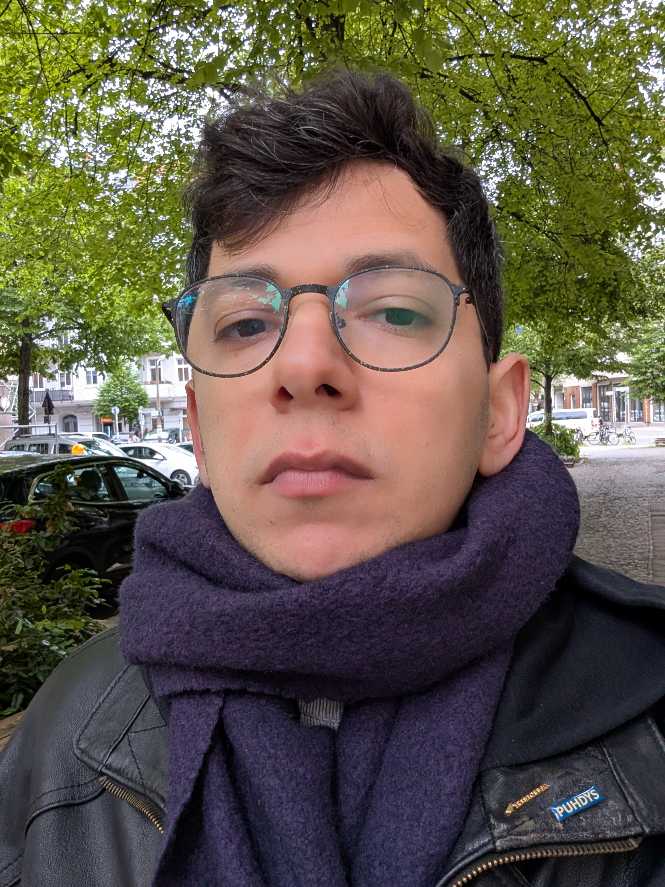

{class="aside"}

I am a filmmaker and visual artist. My work spans film, video, animation, motion design and illustration.

I've worked for many years as a freelance motion designer in the corporate sector, while developing my own personal projects in my spare time. Though my professional freelance work is very sleek and clean, my personal work is less polished, often darker in tone and more rough around the edges. It comes from a place of personal psychological introspection. 

My short films have screened at notable festivals including Hollyshorts, Filmquest and the Austin Arthouse Film Festivals.

I currenty live and work in Berlin.